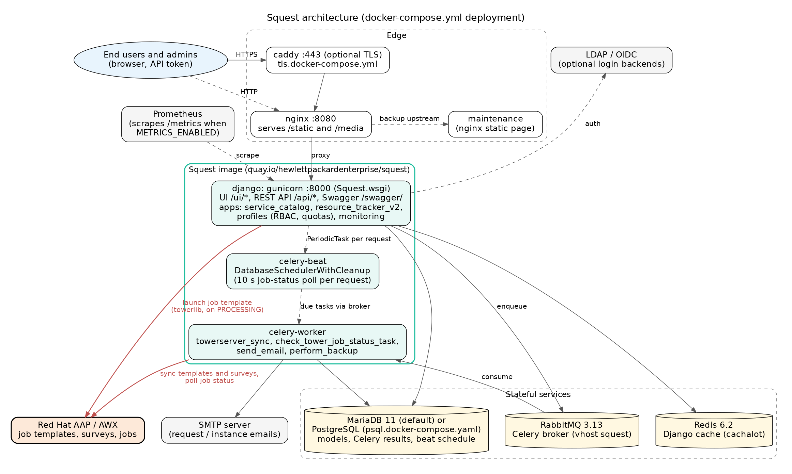

# Architecture

This page describes what the code on `master` does today: the processes Squest runs, the Django apps inside them, and
how a service request reaches Red Hat Ansible Automation Platform (RHAAP) or AWX and comes back.

The diagram source is [`docs/diagrams/architecture.dot`](../diagrams/architecture.dot) (Graphviz). Edit it, then run
`docs/diagrams/render.sh` to regenerate `docs/images/architecture.png` and `docs/images/architecture.svg`.

## Runtime processes

`docker-compose.yml` starts every process. The `django`, `celery-worker` and `celery-beat` services run the same
image (`quay.io/hewlettpackardenterprise/squest`) with a different command.

| Service | Command / image | Role |
|---|---|---|
| `nginx` | `nginx:1.23.4-alpine`, `docker/nginx.conf` | Listens on 8080 (published by `docker-compose.override.yml`). Serves `/static` and `/media` from shared volumes and proxies the rest to `django:8000`. The `maintenance` container is its backup upstream. |
| `maintenance` | `nginx:1.23.4-alpine` | Static "under maintenance" page shown when Django is down. |
| `tls` (optional) | `caddy:2.6.4-alpine`, `tls.docker-compose.yml` | Terminates TLS on 443 with `docker/certs/squest.{crt,key}` and forwards to nginx. |
| `django` | `docker/entrypoint.sh` | Runs `migrate`, `collectstatic` and `insert_default_data`, then `gunicorn Squest.wsgi` on 8000. Serves the UI, the REST API and Swagger. |
| `celery-worker` | `celery -A service_catalog worker` | Runs the asynchronous tasks in `service_catalog/tasks.py`. |
| `celery-beat` | `celery -A service_catalog beat` | Schedules periodic tasks stored in the database (`django_celery_beat`) with `service_catalog.celery_beat_scheduler.DatabaseSchedulerWithCleanup`. |
| `db` | `mariadb:11.0.2` | Main database. `psql.docker-compose.yaml` swaps in PostgreSQL; `Squest/db_router.py` picks the `default` (MySQL/MariaDB) or `psql` connection from the `DATABASE` environment variable. |
| `rabbitmq` | `rabbitmq:3.13.2-management` | Celery broker (`CELERY_BROKER_URL`, vhost `squest`). |
| `redis-cache` | `redis:6.2.13-alpine` | Django cache backend; `django-cachalot` caches ORM queries in it. Tests, `DEBUG` and management commands use a dummy cache instead. |

Celery results are stored in the database (`CELERY_RESULT_BACKEND = "django-db"`). Kubernetes deployments use the
Ansible role in `k8s/squest_k8s`, which creates the same components (database, RabbitMQ, Redis, maintenance page,
Django, Celery and backup).

## Django project layout

| Path | Contents |
|---|---|
| `Squest/` | Project package: `settings.py` (all configuration comes from environment variables, see `docker/environment_variables/`), `urls.py`, the maintenance-mode middleware, the DB router, LDAP and OIDC config, the API token authentication, and the shared base classes in `Squest/utils/` (`SquestModel`, generic views, tables, filters, RBAC helpers, `ansible_when`). |
| `service_catalog/` | Core app: RHAAP/AWX servers (`TowerServer`), job templates and surveys, portfolios, services, operations, requests, instances, approval workflows, hooks, custom links, docs, announcements, support tickets, email templates and the global `SquestSettings`. Also the Celery app (`celery.py`), tasks, mail helpers and the management commands. |
| `resource_tracker_v2/` | Resource tracking: attribute definitions, resource groups, resources (optionally linked to a service catalog `Instance`) and transformers that consume one group's attribute from another. |
| `profiles/` | Users and access: organizations, teams, the global scope, roles and role bindings (RBAC), quotas, API tokens and notification filters. |
| `monitoring/` | Prometheus exporter at `/metrics/`, mounted only when `METRICS_ENABLED`. |
| `plugins/` | User-provided Python validators (`field_validators/`, `survey_validators/`) loaded at run time; mounted as a volume in Docker. |
| `templates/`, `project-static/` | Django templates and static assets; JS/CSS libraries come from `package.json` through `django-node-assets`. |
| `tests/` | Django `TestCase` suite, mirroring the app layout, run on an in-memory SQLite database with eager Celery. |
| `scripts/` | CI helpers: `patch_coverage.py`, `spawn_coverage_session.py` and `create_github_url_issue.py`. |
| `docs/`, `mkdocs.yml` | This MkDocs site. |
| `docker/`, `*.docker-compose.y*ml`, `k8s/` | Deployment files. |

### URL map

| Prefix | Served by |
|---|---|
| `/ui/` | Home dashboard (`Squest/views.py`) |
| `/ui/service-catalog/`, `/api/service-catalog/` | `service_catalog` views and REST API |
| `/ui/resource-tracker/`, `/api/resource-tracker/` | `resource_tracker_v2` views and REST API (the UI has no page at the bare prefix; start at `/ui/resource-tracker/resource-group/`) |
| `/ui/profiles/`, `/api/profiles/` | `profiles` views and REST API |
| `/api/tasks/<id>/` | Celery task result |
| `/swagger/`, `/redoc/`, `/swagger.json` | OpenAPI schema from `drf-yasg` |
| `/accounts/` | Login (local, LDAP when `LDAP_ENABLED`, OIDC when social auth is enabled) |
| `/admin/` | Django admin |
| `/metrics/` | Prometheus metrics when `METRICS_ENABLED` |

## Request lifecycle

The request and instance state machines are defined with `django-fsm` and documented in
[Request state machine](request-state-machine.md) and [Instance state machine](instance-state-machine.md).

1. An admin adds a `TowerServer`. Creating it syncs the job templates and their surveys from RHAAP/AWX with
   `towerlib`; later syncs (UI button or `/api/service-catalog/tower/<id>/job-template/sync/`) queue the `towerserver_sync` task.
2. Admins expose job templates as `Service`s with `Operation`s (create, update, delete) in a `Portfolio`.
3. A user fills in the survey: Squest creates an `Instance` (`PENDING`) and a `Request` (`SUBMITTED`) on a quota scope
   (organization or team). If an `ApprovalWorkflow` matches the operation and scope, its `ApprovalStep`s must accept the
   request in order; quotas are checked against the resource tracker.
4. When the request is processed (`Request.perform_processing`), Django merges the survey answers with the extra vars
   of the tower server, service and operation, adds a `squest` variable with the serialized request, and launches the
   job template through `towerlib`.
5. It then creates a `django_celery_beat` `PeriodicTask` that runs `check_tower_job_status_task` every 10 seconds until
   the operation's `process_timeout_second` expires.
6. The worker polls the RHAAP/AWX job. On `successful` the request moves to `COMPLETE` and the instance to `AVAILABLE`
   (or `DELETED` for a delete operation); on `failed` or `canceled` the request moves to `FAILED`. Either way the
   periodic task is deleted and `send_email` notifies the users who match the notification filters.
7. Every request or instance state change also runs any matching `RequestHook` or `InstanceHook`, which launch other
   job templates (`service_catalog.models.hooks.HookManager`).

The playbook running in RHAAP/AWX can call the Squest REST API with the `squest` extra var to update the instance spec
or link resources.

## Other periodic and background jobs

- `perform_backup` runs `dbbackup` and `mediabackup` on `BACKUP_CRONTAB` when `BACKUP_ENABLED`.
- `task_cleanup_ghost_docs_images` (scheduled as `cleanup_martor`) removes uploaded Markdown images no doc refers to.

## Management commands

| Command | Use |
|---|---|
| `insert_default_data` | Creates the users listed in `default_data.yml` (the `admin` superuser) if they do not exist. Runs on every container start; default roles and permissions come from the migrations. |
| `insert_demo_data` | Seeds a demo database (users `alice`, `bob`, `carol`, a placeholder AAP server, services, instances, requests, support tickets and resource groups). Needs no reachable AAP/AWX. Refuses to run unless `DEBUG` is on or `--force` is passed, because each demo user's password is their username. |
| `insert_testing_data` | Larger random data set for manual testing. |
| `martor_cleanup` | Same cleanup as `task_cleanup_ghost_docs_images`. |
| `import_resource_tracker_v1` | Migrates data from the removed resource tracker v1. |

## CI

| Workflow | What it does |
|---|---|
| `on-pull-request-workflow.yml` | On every pull request: installs with Poetry on Python 3.12, runs `coverage run --source='.' manage.py test`, uploads the HTML report and Coveralls. Then `scripts/patch_coverage.py` measures the coverage of the lines the PR changed. The job fails if project coverage is under 90% or patch coverage is under 85%. When patch coverage fails on a branch of this repository, `scripts/spawn_coverage_session.py` starts one Devin session (labelled `devin-coverage-backfill`) to add the missing tests, and the session link is commented on the PR. PRs that only touch `tests/` skip the patch gate. |
| `on-merge-master.yml` | On push to `master`: builds this MkDocs site and publishes it to GitHub Pages with `mike`. |
| `build-and-publish-docker-image.yml` | On push to `master` or `dev`: builds `docker/squest.Dockerfile` and pushes it to quay.io as `<version>` and `latest` (or `dev`). |
